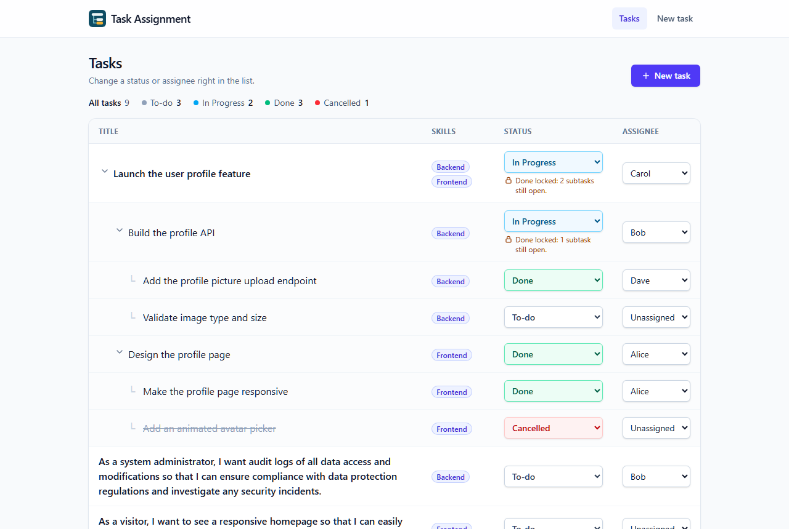
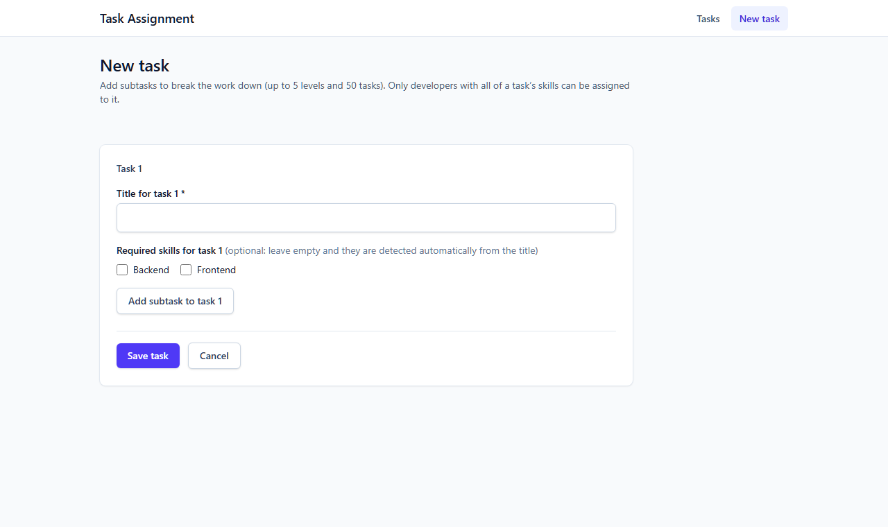
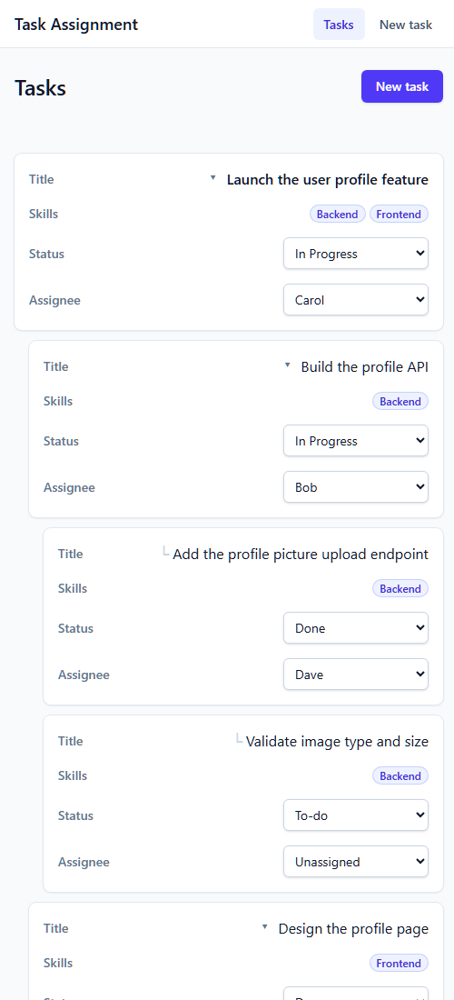
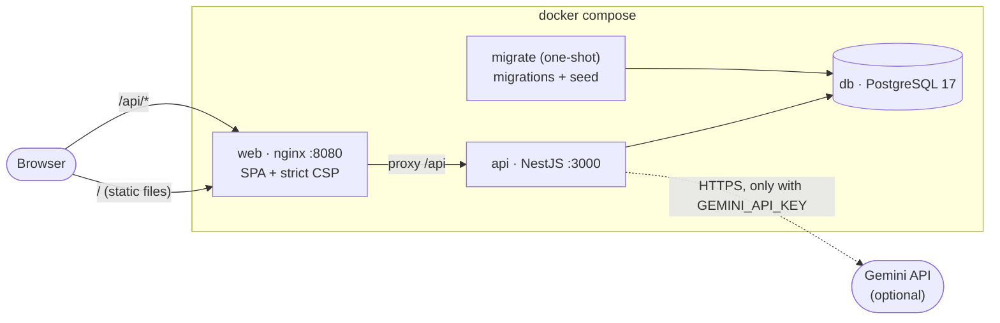
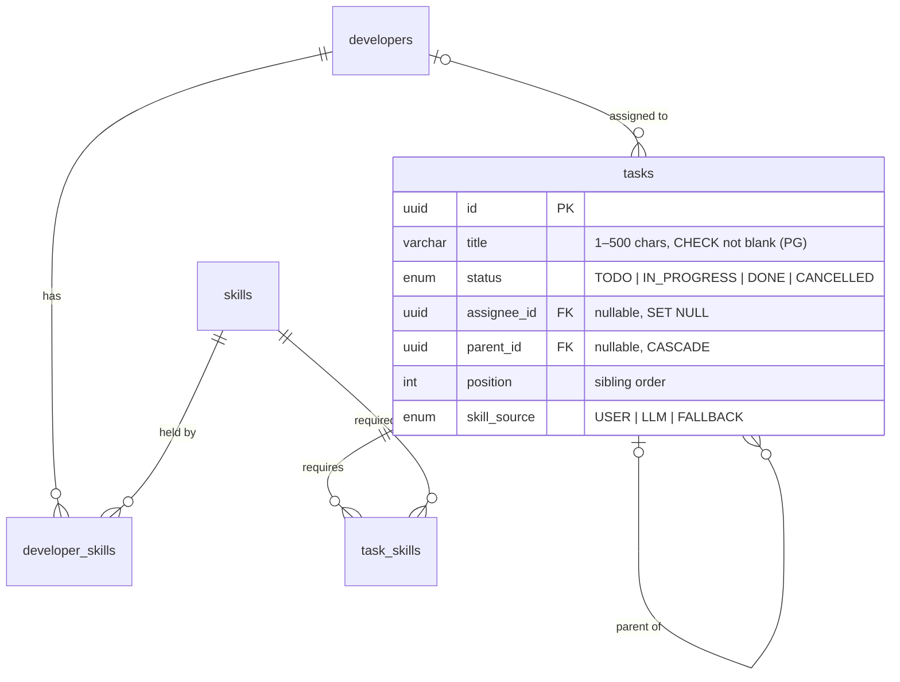

# Task Assignment App

A full-stack app for assigning development tasks: **developers** have **skills**, **tasks** require skills and can be nested into **subtasks** of any depth, and a task can only be assigned to a developer who has every skill it requires. Tasks created without skills get them inferred from their title by an LLM on the backend, with a deterministic fallback, so the app works without any API key.

**Contents:**
[1. Overview](#1-overview) · [2. Quick start](#2-quick-start) · [3. Configuration](#3-configuration) · [4. System design](#4-system-design) · [5. API](#5-api) · [6. Design patterns](#6-design-patterns) · [7. Dependency choices](#7-dependency-choices) · [8. Security](#8-security) · [9. Assumptions and decisions](#9-assumptions-and-decisions) · [10. Testing](#10-testing) · [11. Roadmap](#11-roadmap) · [12. AI-assisted development](#12-ai-assisted-development)

---

## 1. Overview

| Task tree (desktop) | Create a task tree | Mobile |
|---|---|---|
|  |  |  |

**Features**
- **Task list (`/`):** Title / Skills / Status / Assignee, with subtasks indented under their parent and collapsible. Status and assignee change in place, optimistically, and roll back with the server's reason if refused.
- **Skill-matched assignment:** the assignee list only offers developers whose skills cover the task, and the API enforces the same rule.
- **Subtasks of any depth** (up to 5 levels / 50 tasks per request): created in one go with a recursive editor (1 / 1.1 / 1.1.1 …).
- **"Done" means done:** a task can be Done only when every subtask at any depth is Done or **Cancelled**. Reopening a Done or Cancelled subtask under a Done parent asks for confirmation, then moves those parents back to In Progress.
- **Sticky navigation:** the top bar stays in place while scrolling long task lists.
- **Skill inference:** leave a task's skills empty and they're inferred from its title (Gemini, or keyword rules when no key is configured). Inferred skills are marked "AI" or "Auto".
- **One command to run:** `docker compose up --build`.

**Stack:** NestJS 11 + Prisma 7 + PostgreSQL 17 · React 19 + Vite + TanStack Query + Tailwind · Gemini via `@google/genai` · Jest/supertest and Vitest/React Testing Library · Docker + nginx. SQLite is used only for fast local development.

---

## 2. Quick start

### Run everything with Docker (recommended)

Requires Docker Desktop (or Docker Engine with Compose v2).

```powershell
git clone https://github.com/HiroshiFuu/htx-task-assignment-fenghao.git
cd htx-task-assignment-fenghao
Copy-Item .env.example .env      # macOS/Linux: cp .env.example .env
docker compose up --build        # then open http://localhost:8080
```

No Node.js or local database is needed. The placeholder values in `.env` work as-is; `GEMINI_API_KEY` is optional (see [Configuration](#3-configuration)). `docker-compose.override.yml` is loaded automatically for development: it binds the app to `127.0.0.1:8080` and publishes PostgreSQL on `127.0.0.1:5433`. For a production-like run without it: `docker compose -f docker-compose.yml up --build`. The stack starts in order:

```
db (PostgreSQL 17, healthy) → migrate (apply migrations + idempotent seed, then exit)
                             → api (NestJS, healthy) → web (nginx: SPA + /api proxy, port 8080)
```

The database is seeded with four developers (Alice [Frontend], Bob [Backend], Carol [Frontend, Backend], Dave [Backend]), the two skills and a sample task tree. `docker compose down -v` removes everything including the database volume.

### Local development

Requires Node.js 24 LTS and npm 11. The backend uses **SQLite** locally, so no Docker is needed.

```powershell
# Backend
cd backend
npm install
Copy-Item .env.example .env
npm run db:reset        # rebuild SQLite: schema → db push → generate → seed
npm run start:dev       # http://localhost:3000/api · Swagger UI: http://localhost:3000/api/docs

# Frontend (second terminal)
cd frontend
npm install
npm run dev             # http://localhost:5173 (proxies /api to the backend)
```

The Vite dev server proxies `/api` to `http://localhost:3000`, mirroring the same-origin nginx setup in production, so no CORS is needed. If the backend runs elsewhere, set `API_PROXY_TARGET` before `npm run dev` (e.g. `$env:API_PROXY_TARGET="http://localhost:3001"`); it is read only by the dev server and never bundled.

**PostgreSQL in development** (creating migrations, running the e2e suite against PostgreSQL):

```powershell
Copy-Item .env.example .env          # repo root
docker compose up -d db              # 127.0.0.1:5433 (from docker-compose.override.yml)
cd backend
Copy-Item .env.pg.example .env.pg    # keep its password in sync with the root .env
npm run db:migrate:pg -- --name <migration_name>   # the only way to create migrations
npm run db:reset:pg                  # apply all migrations + generate + seed
npm run test:e2e:pg
```

After switching back to SQLite, `npm run db:reset` or `npm run start:dev` regenerates the SQLite client.

### Windows notes
- npm scripts are cross-platform (no `rm -rf` / `export`); files use LF line endings via `.gitattributes`.
- Stop `start:dev`, Prisma Studio and DB clients before `npm run db:reset`: Windows locks `dev.db`.
- After pulling a schema change, run `npm run db:reset` (with `start:dev` stopped); otherwise the running API reports missing columns.
- `better-sqlite3` is a native module: use a Node LTS release so prebuilt binaries are available.

---

## 3. Configuration

Docker reads the root [`.env`](.env.example); local development reads [`backend/.env`](backend/.env.example) and, for PostgreSQL scripts, [`backend/.env.pg`](backend/.env.pg.example). Only the `*.example` files are committed.

| Variable | Where | Default | Purpose |
|---|---|---|---|
| `POSTGRES_USER` / `POSTGRES_PASSWORD` / `POSTGRES_DB` | root `.env` | `app` / `change-me` / `tasks` | Docker database credentials. Compose builds the API's `DATABASE_URL` from them, so keep the password URL-safe (letters, digits, `- . _ ~`). |
| `DATABASE_URL` | `backend/.env`, `.env.pg` | `file:./prisma/dev.db` | `file:` → SQLite, `postgresql://` → PostgreSQL. Prisma's config and client pick the matching schema and driver from it. |
| `GEMINI_API_KEY` | both | _(empty)_ | Optional. Enables LLM skill inference. Use your own free key from [Google AI Studio](https://aistudio.google.com/apikey). Without it the API infers skills with keyword rules and logs a warning. |
| `GEMINI_MODEL` | both | `gemini-3.1-flash-lite` | Gemini model; check AI Studio for currently available names. |
| `ENABLE_SWAGGER` | both | `false` in Docker, on in development | Serves Swagger UI at `/api/docs`. |
| `THROTTLE_TTL_MS` / `THROTTLE_LIMIT` | both | `60000` / `100` | Global rate limit per client. |
| `THROTTLE_CREATE_TASK_LIMIT` | both | `10` | Stricter limit for `POST /api/tasks`, which may call the LLM. |
| `TRUST_PROXY_HOPS` | API | `0` (`1` in Docker) | Reverse proxies in front of the API, so rate limits see real client IPs. Leave `0` without a proxy: otherwise clients could spoof `X-Forwarded-For`. |
| `PORT` | `backend/.env` | `3000` | API port. |

**Keeping the API key safe in a public repo:** the key lives only in your local, gitignored `.env`. It is read by the backend only (never a `VITE_` variable, never in the browser bundle), passed to the `api` container at runtime (never a Docker build argument), and never logged. Each reviewer uses their own key, or none. `docker compose config` prints resolved secrets, so use `--quiet` or `--no-interpolate` before sharing its output.

---

## 4. System design

### Architecture



A **modular monolith**: one NestJS service with modules `skills`, `developers`, `tasks` and `skill-inference`, plus `common` (Prisma, error format, config, health). nginx serves the React build and proxies `/api` on the same origin, so there is no CORS. In `docker-compose.yml` only port 8080 is published; the development override, loaded by default, additionally publishes PostgreSQL on `127.0.0.1:5433` (see [Known trade-offs](#known-trade-offs)).

**Backend layering:** controller (HTTP only) → service (one method per use case, the Facade) → rules (pure business rules) → repository (Prisma). Errors are RFC 7807 problem+json from one global filter.

### Data model



| Table | Notes |
|---|---|
| `skills` | `name` unique, varchar(50) |
| `developers` | `name` varchar(100) |
| `developer_skills` | PK (`developer_id`, `skill_id`); deleting a developer cascades, deleting a skill in use is restricted |
| `tasks` | see diagram; subtasks are deleted with their parent |
| `task_skills` | PK (`task_id`, `skill_id`); cascades with the task, restricted for skills |

- **Indexes:** `idx_tasks_parent_id`, `idx_tasks_assignee_id`, `idx_task_skills_skill`, `idx_dev_skills_skill` (composite primary keys already cover lookups by their leading column).
- **Migrations** (PostgreSQL only, in `backend/prisma/migrations/`) show how the schema evolved: `init` (with a hand-added `CHECK (length(trim(title)) > 0)` that Prisma can't express), `add_subtasks` (`parent_id`, its index, `position`), `add_skill_source`, `add_cancelled_status`.
- **`position`:** siblings created in one request can share a `created_at` millisecond and their random UUIDs carry no order, so an explicit position keeps 1.1 before 1.2.
- **Seed** (`prisma/seed.ts`): idempotent upserts with fixed UUIDs. Because it bypasses the API, an e2e test checks the sample data against the real business rules.

### Business rules

| Rule | Behaviour |
|---|---|
| **Skill match** (D3) | A developer can take a task only if their skills include **all** of the task's skills → otherwise 422 `SKILL_MISMATCH` listing `missingSkills`. Subtasks follow the same rule (D9). |
| **Done rule** (D4, D15) | A task can be Done only when **every descendant** at any depth is **closed** (Done or Cancelled) → otherwise 422 `SUBTASKS_NOT_DONE` listing `openSubtasks`. Cancelling is always allowed, even with open subtasks. |
| **Cascade rollback** (D5) | Reopening a closed task (Done or Cancelled → To-do / In Progress) whose ancestors are Done returns **409** `CASCADE_CONFIRMATION_REQUIRED` with `affectedTasks` and changes nothing. Resubmitting with `confirmCascade: true` updates the task and moves every Done ancestor to `IN_PROGRESS` in the same transaction, recomputing the affected set server-side. Done ↔ Cancelled keeps the task closed, so it never cascades. This keeps the invariant "a Done task has only closed descendants". |
| **Never without skills** (D6) | Skills left empty are inferred; if the LLM fails or is not configured, keyword rules decide, and a title matching nothing requires every skill (the conservative choice). |

Rules form a chain (`runRuleChain`) that returns `allow` (optionally with tasks to cascade), `reject` (→ 422) or `requireConfirmation` (→ 409). The service loads the task with its ancestors and descendants; the rules are pure functions of that snapshot and are unit-tested without a database. The server is always the authority; the UI only predicts (it disables "Done" while subtasks are open and opens the confirmation dialog straight away when the cached tree shows Done parents).

### Concurrency

- **Creating a tree** is a single transaction (Prisma nested create).
- **A status change** finds the task's ancestors and descendants with `WITH RECURSIVE` queries, **locks all those rows**, re-reads them, evaluates the rules and writes, all in one transaction, so two concurrent changes can't break the Done invariant. The ids can be read before locking because a tree's shape never changes after creation (there are no re-parent or delete endpoints).
- **Assignment** locks the task row before checking the skill match.
- **Dialect differences live in one place:** `RowLockStrategy` uses `SELECT … FOR UPDATE ORDER BY id` on PostgreSQL (one lock order, no deadlocks) and is a no-op on SQLite, which allows one writer at a time. All other SQL (`WITH RECURSIVE`, standard joins) is shared and runs on both.
- **No network call inside a transaction:** skill inference runs before the transaction opens.

### Skill inference

```
POST /api/tasks
  1. Collect every node of the tree without skillIds   (user-chosen skills stay USER)
  2. classifier.classifyBatch(titles, skill names)      ← one call per tree, before any transaction
  3. Transaction: validate skills, write the tree with skill_source
```

| Component | Role |
|---|---|
| `SkillClassifier` | Interface: `classifyBatch(items, allowedSkills)` |
| `GeminiClassifier` | Wraps `@google/genai`; the SDK's types never leave the `skill-inference` module |
| `ResilientClassifier` | 10s timeout (request aborted), one retry with backoff on 429/5xx/network errors, then keyword fallback for anything unlabelled → `FALLBACK` |
| `KeywordClassifier` | Deterministic rules: UI/page/responsive → Frontend; API/database/logs/audit/security → Backend; upload/profile → both |
| `createSkillClassifier` | With `GEMINI_API_KEY`: Resilient(Gemini → Keyword). Without: Keyword only, plus a startup warning |

The three examples from the brief are acceptance tests: "responsive homepage…" → Frontend; "audit logs of all data access…" → Backend; "update my profile … and upload a profile picture…" → Frontend + Backend.

### Frontend

- **Server state** only in TanStack Query; the create form's tree in a `useReducer` (`ADD_SUBTASK`, `REMOVE_NODE`, `UPDATE_TITLE`, `TOGGLE_SKILL`, `RESET`, addressed by path).
- **Optimistic updates** for status and assignee, with per-task rollback and the server's reason announced. Cascading status changes are **not** optimistic: they open a confirmation dialog (native `<dialog>`, focus on Cancel, Esc cancels) and refetch the tree afterwards.
- **Accessibility:** semantic `<table>`, a label for every control, errors linked with `aria-describedby`/`aria-invalid`, feedback in an `aria-live="polite"` region, a skip link, keyboard-only use, focus moved to new subtasks and to the first invalid field.
- **Responsive:** below the `md` breakpoint each row becomes a card from the same DOM, so controls are never duplicated.
- **Robustness:** route-level code splitting, a router error boundary, loading/empty/error states, and a typed API client that turns problem+json into `ApiError`.

### Local SQLite, production PostgreSQL (D13)

`backend/prisma/schema.prisma` (PostgreSQL) is the single source of truth. `scripts/gen-sqlite-schema.ts` derives the SQLite schema, `prisma.config.ts` picks the schema from `DATABASE_URL`, and `createPrismaClient()` picks the matching driver adapter. SQLite is rebuilt with `db push` and never gets migrations. `prisma generate` writes the typed client to `backend/src/generated/` (gitignored); it is provider-specific, so the scripts regenerate it when switching. Safety guards: `db:reset` refuses production, non-`file:` URLs and files outside `backend/prisma/`; the PostgreSQL scripts refuse non-local hosts. The cost of two dialects is controlled by running the full e2e suite on **both**.

---

## 5. API

Base path `/api`. **Swagger UI:** http://localhost:3000/api/docs in development (OpenAPI JSON at `/api/docs-json`); off in Docker unless `ENABLE_SWAGGER=true`.

| Method | Path | Body | Success | Errors |
|---|---|---|---|---|
| GET | `/skills`, `/skills/:id` | | 200 skill(s) with `developers[]` | 400 bad UUID, 404 |
| GET | `/developers`, `/developers/:id` | | 200 developer(s) with `skills[]`, `tasks[]` | 400, 404 |
| GET | `/tasks` | | 200 `TaskNode[]`: top-level tasks, `subtasks` nested | |
| GET | `/tasks/:id` | | 200 `TaskNode` with its whole subtree | 400, 404 |
| POST | `/tasks` | `{ title, skillIds?, subtasks? }` (recursive) | 201 `TaskNode` tree (status `TODO`, unassigned) | 400, 422 `UNKNOWN_SKILL`, 429 |
| PATCH | `/tasks/:id/status` | `{ status, confirmCascade? }` | 200 `{ task, cascadedTaskIds }` | 400, 404, 409 `CASCADE_CONFIRMATION_REQUIRED`, 422 `SUBTASKS_NOT_DONE` |
| PATCH | `/tasks/:id/assignee` | `{ developerId: uuid \| null }` | 200 `TaskNode` | 400, 404, 422 `SKILL_MISMATCH` / `UNKNOWN_DEVELOPER` |
| GET | `/health` | | 200 `{status:"ok"}` (database probed) | 503; internal only in Docker |

```ts
TaskNode = {
  id: string; title: string; status: 'TODO' | 'IN_PROGRESS' | 'DONE' | 'CANCELLED';
  skills: { id: string; name: string }[]; skillSource: 'USER' | 'LLM' | 'FALLBACK';
  assignee: { id: string; name: string } | null;
  parentId: string | null; subtasks: TaskNode[];
  createdAt: string; updatedAt: string;
}
```

**Errors** are always `application/problem+json` (RFC 7807):

```json
{
  "type": "/problems/skill-mismatch",
  "title": "Business rule violation",
  "status": 422,
  "detail": "Bob lacks the required skill(s): Frontend.",
  "instance": "/api/tasks/…/assignee",
  "code": "SKILL_MISMATCH",
  "missingSkills": [{ "id": "…", "name": "Frontend" }]
}
```

400 responses carry `errors: [{ field, messages }]` with dotted paths for nested input (`subtasks.0.title`). Responses never contain stack traces, SQL or library messages; 5xx details are generic and the real error is only logged.

**Validation:** unknown fields are rejected at every level (so `POST /tasks` can't set `status`, `assigneeId` or `parentId`). `title` is trimmed, 1–500 characters, with no control characters (C0, DEL, C1) and no bidi override/isolate characters (which would make a title render reversed). `skillIds` are UUIDs, deduplicated, at most 20 per task. A tree has at most 5 levels and 50 tasks; any JSON nested more than 32 levels is rejected before DTO parsing. Bodies are limited to 100kb. Creation and assignment are separate operations.

---

## 6. Design patterns

Each pattern is used where it solves a concrete problem; none for its own sake.

| Pattern | Where | Why |
|---|---|---|
| **Facade** | `TasksService` | Controllers call one method per use case; transactions, locking, rule chains and persistence stay behind it |
| **Chain of Responsibility** | `SkillMatchRule`; `AllDescendantsDoneRule` → `AncestorRollbackRule` via `runRuleChain` | Rules are added without touching the service and tested alone; ordering makes a hard rejection (422) win over a confirmation request (409) |
| **Composite** | Backend `buildTaskForest` (a `TaskNode`'s subtasks are `TaskNode`s); frontend `TaskNodeEditor` renders itself for each subtask | A task and a tree of tasks are handled the same way, so creating, reading and editing work at any depth |
| **Strategy** | `SkillClassifier` → `GeminiClassifier` / `KeywordClassifier` (and test doubles); `RowLockStrategy` → PostgreSQL / SQLite | Skill inference can change provider or run without one; the single SQL dialect difference stays out of business code |
| **Adapter** | `GeminiClassifier` wraps `@google/genai` | The SDK's types stay inside `skill-inference`; the rest of the app sees plain data |
| **Decorator** | `ResilientClassifier` | Timeout, retries and fallback wrap any classifier without changing it, and are unit-tested on their own |

---

## 7. Dependency choices

| Dependency | Why |
|---|---|
| NestJS 11 | Modules, DI and pipes/filters give the layered structure for free. v11 rather than 12: Nest 12 is ESM-only, which conflicts with Jest and the CommonJS Prisma setup; v11 is still supported |
| `prisma` / `@prisma/client` 7 | Typed data access and a reviewable migration history; v7 uses driver adapters |
| `@prisma/adapter-pg` | Runtime driver for PostgreSQL |
| `@prisma/adapter-better-sqlite3` (dev) | Driver for local SQLite; dev-only, so the production image has no native SQLite module |
| `class-validator`, `class-transformer` | Declarative whitelist validation of nested DTOs in Nest's `ValidationPipe` |
| `@nestjs/swagger` | OpenAPI document and Swagger UI generated from controllers and DTOs |
| `helmet` | Secure HTTP headers with safe defaults |
| `@nestjs/throttler` | In-process rate limiting; no Redis needed for a single instance |
| `@google/genai` | Google's official Gemini SDK; JSON-schema-constrained output and abort signals |
| `zod` | Runtime validation of the LLM's JSON before it is trusted |
| `dotenv`, `dotenv-cli` (dev), `tsx` (dev) | Load `.env` files and run TypeScript scripts (seed, DB reset) cross-platform without shell-specific syntax |
| `react-router` | Client routing with route-level code splitting |
| `@tanstack/react-query` | Server-state cache with optimistic updates, rollback and refetching |
| `tailwindcss`, `@tailwindcss/vite` (dev) | Utility CSS compiled to a static file: no inline styles, so a strict CSP works |
| Jest + supertest, Vitest + React Testing Library + jsdom + `user-event` (dev) | Unit and HTTP e2e tests on the backend; user-centric, accessibility-oriented component tests on the frontend |
| ESLint + typescript-eslint + Prettier (dev) | Type-aware linting (`any` forbidden, `dangerouslySetInnerHTML` banned) and consistent formatting |

---

## 8. Security

### Threat model (STRIDE, short)

| Threat | Example | Mitigation |
|---|---|---|
| **Spoofing** | Faking another client's IP to dodge rate limits | nginx overwrites `X-Forwarded-For`; the API trusts exactly one proxy hop. _No user authentication in v1 (accepted, see below)._ |
| **Tampering** | Mass assignment (`status`, `assigneeId` on create); SQL injection; racing two status changes | Whitelist DTOs reject unknown fields at every level; only parameterised `$queryRaw` templates (`$queryRawUnsafe` banned by lint); row locks + transactions for every check-then-write |
| **Repudiation** | No record of who changed what | _Accepted for v1 (no users); audit logging is on the roadmap_ |
| **Information disclosure** | Stack traces/SQL in errors; leaked API key; titles sent to a third party | Curated problem+json errors; key only in gitignored `.env`, server-side, never logged or baked into images; privacy note on the LLM (below) |
| **Denial of service** | Huge or deeply nested JSON, task-tree bombs, LLM cost abuse | 100kb body limit (API and nginx), JSON depth ≤ 32 checked iteratively, ≤ 5 levels / ≤ 50 tasks per tree, global + stricter create rate limits, LLM timeout/retry bounds, container memory limits |
| **Elevation of privilege** | Prompt injection steering the LLM; container breakout | Titles sent as JSON data marked untrusted, output limited to an enum of DB skill names and re-validated, model text never stored; non-root app containers with no capabilities, `no-new-privileges` on every container, read-only API filesystem |

### Controls in place
- **Input:** global `ValidationPipe` (`whitelist`, `forbidNonWhitelisted`, `transform`), UUID path params, trimmed and length-checked titles without control or bidi-override characters (same rule in the frontend); validation is complete in the API because SQLite enforces neither enums nor the CHECK constraint.
- **Errors:** RFC 7807 everywhere; parser and framework messages replaced with fixed text; 5xx details logged, not returned.
- **HTTP:** helmet on the API; strict CSP (`default-src 'self'`, no inline script or style), `X-Frame-Options: DENY`, `nosniff` and `Referrer-Policy` on the SPA; `server_tokens off`; only GET/HEAD/POST/PATCH proxied; the health endpoint is blocked at nginx in every case/trailing-slash variant and is rate limited in the API; Swagger off in Docker.
- **LLM:** see [Skill inference](#skill-inference); logs contain counts and HTTP status codes only, never titles, SDK messages or the key; tests always replace the classifier, so they can never call the real API.
- **Containers:** multi-stage builds and pinned base images; the app containers (`api`, `migrate`, `web`) run as non-root users with `cap_drop: ALL`; every container has `no-new-privileges` and a memory limit (`db` keeps the capabilities the postgres entrypoint needs to switch to its own user); read-only API filesystem with root-owned code; only the web port published by `docker-compose.yml`; the key passed at runtime only; `.dockerignore` excluding `.env`.
- **Repository:** `.env` files are gitignored; only `*.example` placeholders are committed (all history scanned: no keys).
- **Process:** every phase was reviewed by a security-focused review pass; Critical/High findings were fixed before moving on, the rest are tracked in the [Roadmap](#11-roadmap).

### Known trade-offs
- **No authentication or authorization** (D1): anyone who can reach the app can change any task. Acceptable for this exercise; the Docker dev override binds the app to `127.0.0.1` so it isn't exposed on the LAN. The Nest Guard slot for auth is reserved.
- **LLM data policy:** with a key configured, task titles without skills (up to 50 per request) are sent to Google's Gemini API, and on the free tier Google may use inputs to improve its products. Don't put personal or confidential data in titles, or leave `GEMINI_API_KEY` empty to keep everything local. Only the resulting skill labels are stored.
- **Database role:** the API connects as the database owner; a least-privilege runtime role is on the roadmap.
- **Development database port:** the auto-loaded `docker-compose.override.yml` publishes PostgreSQL on `127.0.0.1:5433` (loopback only) with the placeholder password, so other processes on the same machine could connect. It exists for the PostgreSQL e2e workflow; change `POSTGRES_PASSWORD`, or run `docker compose -f docker-compose.yml up --build` to publish only the web port.
- **`npm audit`:** frontend 0 vulnerabilities. Backend: no High/Critical; 2 Moderate in `js-yaml` (via `@nestjs/swagger`), a CPU issue when *parsing* attacker-controlled YAML with merge keys. The app never parses YAML (Swagger only serialises its own document, and Swagger is off in Docker), and the fix requires the Nest 12 major upgrade, so it is tracked rather than forced.

---

## 9. Assumptions and decisions

| # | Question | Decision |
|---|---|---|
| D1 | Authentication | Not in v1; an explicit assumption. The architecture leaves room for a Nest Guard. |
| D2 | Task statuses | `TODO` / `IN_PROGRESS` / `DONE` / `CANCELLED`, shown as "To-do" / "In Progress" / "Done" / "Cancelled". |
| D3 | Skill-match semantics | A developer's skills must be a **superset** of the task's required skills. |
| D4 | Scope of the Done rule | **All descendants** (recursive), not just direct children. |
| D5 | Reopening a subtask whose parent is Done | **Cascade rollback with confirmation:** every Done ancestor moves back to `IN_PROGRESS`; without confirmation the server returns 409 listing them, and the client resubmits with `confirmCascade: true`. Keeps "a Done task has only closed descendants". |
| D5b | Rollback target status | `IN_PROGRESS`: part of the parent's work is already complete, so this is more accurate than `TODO`. |
| D6 | A task ending up without skills | Not allowed: the LLM infers them; if it fails or returns nothing, keyword rules decide. |
| D7 | Unassigning | Allowed with `developerId: null`. |
| D8 | Subtask skills | Independent of the parent; each task's skills come from its own title. |
| D9 | Subtask assignee | Same rules as any task, including the skill match. |
| D10 | Nesting limits | Depth ≤ 5 and ≤ 50 tasks per create request (DoS protection). |
| D11 | Editing a task's skills / deleting tasks | Not required by the brief; not provided in v1. |
| D12 | LLM model | Configurable via `GEMINI_MODEL`; defaults to the Gemini Flash family (`gemini-3.1-flash-lite`). |
| D13 | Local database | **SQLite** for day-to-day development (no Docker, rebuilt in seconds); **PostgreSQL** for Docker, migrations and the PostgreSQL e2e run. The PostgreSQL schema is the single source of truth. |
| D14 | Concurrency control | `RowLockStrategy`: `SELECT … FOR UPDATE` in the transaction on PostgreSQL; no-op on SQLite (single writer). |
| D15 | Cancelled tasks | `CANCELLED` closes a task like `DONE`: cancelled subtasks don't block their parent from being Done, reopening a Cancelled subtask under a Done parent cascades like reopening a Done one, and Done ↔ Cancelled never cascades. A task can be cancelled at any time; its open subtasks are left as they are (no automatic cancel cascade). |

Additional decisions made during implementation: a `position` column for sibling order; keyword-rule results labelled "Auto" rather than "AI" in the UI; cascades not applied optimistically; the classifier called once per tree rather than once per task.

---

## 10. Testing

```powershell
cd backend
npm run lint
npm test                 # unit tests
npm run test:e2e         # HTTP e2e on SQLite
npm run test:e2e:pg      # the same e2e suite on PostgreSQL (needs `docker compose up -d db`)

cd ..\frontend
npm run lint
npm test
```

| Suite | Count | Covers |
|---|---|---|
| Backend unit (Jest) | 71 | Every business rule (incl. a grandchild still open blocking Done, Cancelled subtasks not blocking it, all cascade cases incl. reopening Cancelled); rule chain; tree limits (including a 100,000-level input); JSON depth guard; forest builder; skill resolution; keyword classifier on the brief's examples; Gemini adapter (prompt shape, schema, output filtering, error mapping); resilience decorator (timeout, retries, partial fallback) |
| Backend e2e (supertest) | 86 on SQLite **and** 86 on PostgreSQL | Every endpoint; Swagger on/off by `ENABLE_SWAGGER`; validation and problem+json (no internals leaked); skill match (Carol ✓ / Alice ✗ on a Frontend + Backend task); the 1 / 1.1 / 1.1.1 / 1.1.2 tree in one request; depth/size limits and pathological bodies → 400; Done rule; full cascade (409 with the database unchanged → confirm → ancestors In Progress, sibling still Done); skill inference (one batched call, `USER`/`LLM`/`FALLBACK`); rate limits, including per-client limits behind a proxy and spoofing resistance; seed idempotency and seed data obeying the business rules |
| Frontend (Vitest + RTL) | 56 | Eligibility filter; assignee options; optimistic status/assignee updates with rollback; tree list and collapse; Done disabled while subtasks are open (and enabled once they're Done or Cancelled); Cancelled styling; reopening Cancelled asks for confirmation; cascade dialog (Cancel restores and sends nothing, Confirm sends `confirmCascade`, stale-cache 409 opens it); draft reducer (nested add/remove/update, limits, nested server errors); create page with keyboard focus; API client error handling; AI/Auto badges |

The e2e tests always replace the skill classifier, so they are deterministic and never call Gemini. Beyond automated tests, each phase was checked manually in a browser, and the Docker stack was cold-started from a fresh copy containing only the committed files.

---

## 11. Roadmap

Planned for v2, highest priority first. Items tagged with a phase came from that phase's security review.

| Priority | Item |
|---|---|
| High | User authentication and role-based permissions (a Guard slot is already reserved). |
| High | Separate the migration DB user from the runtime DB user (least privilege). |
| Medium | [P6] `api` and `migrate` share `POSTGRES_USER`, which the official image makes a superuser, so a compromised API would have superuser rights (e.g. `COPY … TO PROGRAM`). Keep the owner role for `migrate` and give `api` a DML-only `app_rw` role with its own `DATABASE_URL` (part of the item above). |
| Medium | CI: lint, tests, `npm audit`, gitleaks, Semgrep, Trivy image scanning. |
| Medium | Structured logging (pino) with correlation IDs and audit logs. |
| Medium | Make LLM skill inference asynchronous (domain events / Observer + outbox) so task creation does not wait for the LLM. |
| Medium | Generate frontend types from OpenAPI (`openapi-typescript`) instead of hand-written types. |
| Medium | [P0] `db-reset.ts` checks the target path lexically (`path.resolve`), so a symlink/junction inside `prisma/` could bypass it; use `realpathSync` and require a `*.db` suffix. |
| Low | Use the State pattern for status transitions if the rules grow more complex. |
| Low | Edit task skills, delete tasks, paginate and filter tasks. |
| Low | Playwright end-to-end tests. |
| Low | Database triggers as defence in depth for the skill-match rule. |
| Low | Cascade confirmations carry `expectedAffectedIds`, so the server asks again if the affected set changed (today `confirmCascade: true` is a blanket yes; flagged again in the P4 review). |
| Low | [P6] Base images (postgres, node, nginx-unprivileged) are pinned by tag, not by `@sha256` digest; pin digests and let Renovate/Dependabot update them. |
| Low | [P6] Compose splices the database password into the connection URL, so `@ : / #` would break it; `.env.example` says to use URL-safe characters. |
| Low | [P5, accepted] All titles of a tree go to the LLM in one request, so one title could try to steer the labels of its siblings. The impact is limited to the attacker's own request and labels stay within the skill enum; the system instruction tells the model each title describes only its own task. |
| Low | [P4] The 422 `openSubtasks` and 409 `affectedTasks` responses include other tasks' titles. Fine in v1 (no auth; `GET /tasks` already shows every title), but they must be filtered by visibility once authentication exists. |
| Low | [P4] `npm audit` (backend) reports 2 moderate `js-yaml` advisories via `@nestjs/swagger`; not reachable (the app never parses YAML) and fixed only by the Nest 12 major upgrade. Re-check when upgrading. |
| Low | [P3] The frontend `fetch` ignores TanStack Query's abort `signal` and has no timeout, so `cancelQueries` doesn't abort in-flight requests and a hung `/api` keeps the page loading. Pass the `signal` combined with `AbortSignal.timeout(...)`. |
| Low | [P2] Nest turns `URIError` and unmatched routes into messages that echo the raw path; return a fixed message per status instead. |
| Low | [P2] Interactive transactions use Prisma's defaults (`maxWait` 2s, `timeout` 5s); under heavy contention the timeout (P2028) becomes a 500. Map it to 503 with `Retry-After` or set explicit limits. |
| Low | [P2] Add an e2e test for concurrent PATCHes on the same task (verifies `FOR UPDATE` serialisation). |
| Low | [P1] The seed upserts skills by `id`; an existing skill with the same name but another id makes it fail (the transaction rolls back, no data loss). Upsert by `name` instead. |
| Low | [P1] `skills.name` uniqueness is case-sensitive ("Frontend" and "frontend" could coexist); normalise skill names in the application. |
| Low | [P1] Seed errors print the full message, which may include the DB host or name (never the password); print only the error code in CI. |
| Low | [P0] `db-reset.ts`: strip `?query` from `DATABASE_URL`, compare `NODE_ENV` case-insensitively, and call `npx --no-install tsx`. |

Accepted by design: on SQLite the `status` enum is unconstrained TEXT and the title CHECK constraint does not exist, so the API validates both itself.

---

## 12. AI-assisted development

This project was built with **Claude Code** (Anthropic's agentic coding tool) under human direction and review. How:

1. **Human-written plan and rules first.** Before any code, I wrote a phased plan (requirements traceability, the decisions D1–D14 above, data model, API contract, acceptance criteria per phase) and a `CLAUDE.md` file of project rules that Claude Code reads every session: fixed tech stack, layering, dialect-portability rules, security baseline, scope guardrails ("no microservices, no Redis…"), Windows/LF constraints, and a Definition of Done. Reference implementations for the trickiest infrastructure (SQLite/PostgreSQL dual setup) were provided up front, to be used without rewriting.
2. **One phase at a time.** Claude Code implemented exactly one phase per session (scaffold → schema → API → frontend → subtasks → LLM → Docker → delivery) and stopped for review. It was not allowed to commit or push: every commit, branch push, PR and merge was done by me after reading the diff.
3. **Built-in verification, not trust.** The Definition of Done required, for every phase: lint and tests green in both packages, the e2e suite passing on **both** SQLite and PostgreSQL, manual checks in a real browser (the agent drove one: creating trees, confirming cascades, checking mobile layout and the CSP), and copy-paste verification steps for me to rerun.
4. **Independent security review per phase.** A separate review agent with a security checklist reviewed each phase's diff. Critical/High findings were fixed before the phase closed; several real issues were caught this way (e.g. a stack overflow on deeply nested JSON, rate limits that would have counted everyone behind nginx as one client, a Prisma engine that would have been downloaded at container start-up). Everything else went into the roadmap above.
5. **Human decisions where it mattered:** choosing between options the agent surfaced (e.g. how to split commits, whether to stack branches, which LLM provider to support), consenting explicitly before destructive database resets, and keeping secrets out of the repository.

The result is still my responsibility: I reviewed the design decisions, read the code, and can explain and change any part of it.
