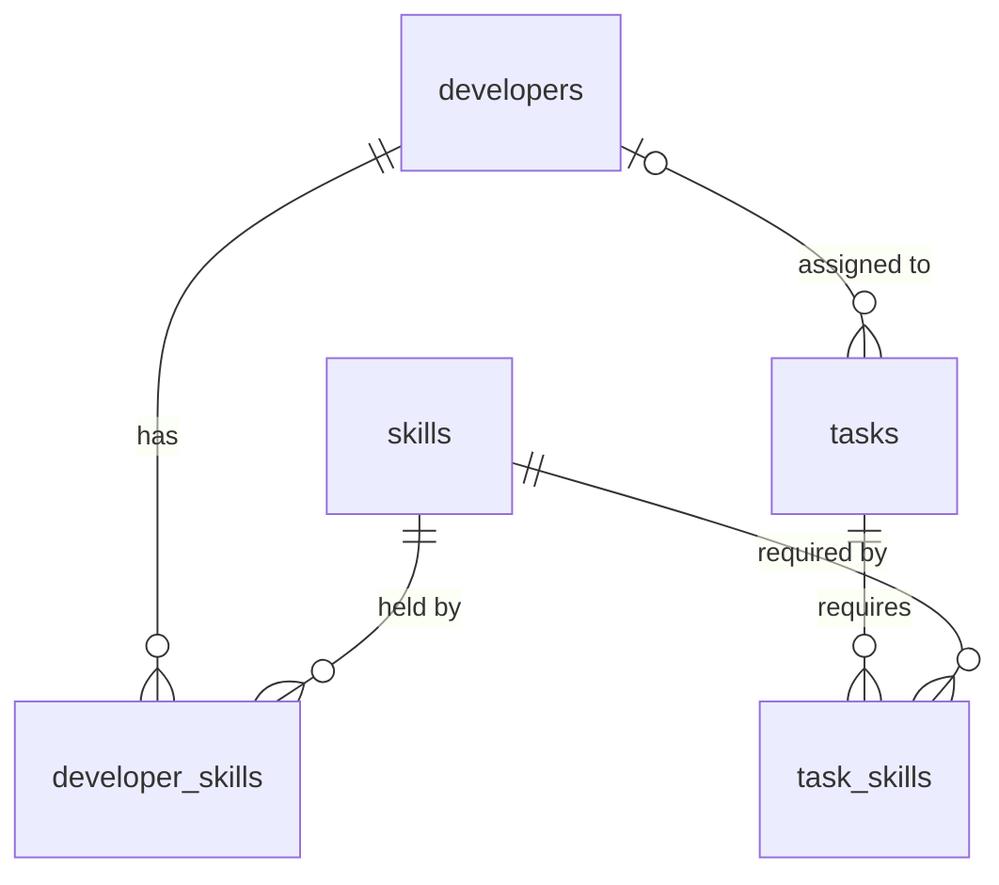

# Task Assignment App

Full-stack task assignment app: Developers, Skills and Tasks (with unlimited nested subtasks). A task can only be assigned to a developer whose skills cover the task's required skills; tasks created without skills get them inferred by an LLM on the backend.

> Status: **Phase P2 (backend REST API)**. Sections marked _TBD_ are filled in by later phases.

## Tech stack

| Layer | Choice |
|---|---|
| Backend | NestJS 11 + TypeScript (strict), Prisma 7 (driver adapters) |
| Database | PostgreSQL 17 (Docker / deployment / migrations); SQLite for local development |
| LLM | Google Gemini via `@google/genai` (optional; keyword fallback) |
| Frontend | Vite + React 19 + TypeScript (strict) |
| Tests | Backend: Jest + supertest. Frontend: Vitest + React Testing Library |
| Deployment | Docker multi-stage builds, nginx reverse proxy |

## Quick start

### Prerequisites
- Node.js LTS (24.x), npm 11
- Docker Desktop (only for PostgreSQL and the full stack)

### Local development (Windows PowerShell)

```powershell
# Backend (SQLite, no Docker needed)
cd backend
npm install
Copy-Item .env.example .env
npm run db:reset        # rebuild SQLite: schema -> db push -> generate -> seed
npm run start:dev       # http://localhost:3000/api, Swagger UI at /api/docs

# Frontend
cd ..\frontend
npm install
npm run dev             # http://localhost:5173
```

### PostgreSQL (migrations and PG e2e)

```powershell
Copy-Item .env.example .env                       # repo root, for docker compose
docker compose up -d db                           # 127.0.0.1:5433, healthcheck
cd backend
Copy-Item .env.pg.example .env.pg
# Change POSTGRES_PASSWORD in .env and keep it in sync with .env.pg
npm run db:migrate:pg -- --name <migration_name>  # the only way to create migrations
npm run test:e2e:pg
```

### Full stack with Docker
_TBD (Phase P6)_: `docker compose up --build` -> http://localhost:8080

### Windows notes
- npm scripts are cross-platform (no `rm -rf` / `export`); files use LF line endings via `.gitattributes`.
- Stop `start:dev`, Prisma Studio and DB clients before `npm run db:reset` (Windows locks `dev.db`).
- `better-sqlite3` is a native module; use a Node LTS release so prebuilt binaries are available.

## Configuration
_TBD (Phase P7)_. See [`.env.example`](.env.example), [`backend/.env.example`](backend/.env.example) and [`backend/.env.pg.example`](backend/.env.pg.example).

## System design
_Architecture diagram: TBD (Phase P7)_. Business rules and concurrency: see [API](#api).

### Prisma generated client
`prisma generate` turns `schema.prisma` into a TypeScript client in `backend/src/generated/prisma/` (gitignored). Prisma 7 emits it into the source tree instead of `node_modules`, so it compiles with the app and is imported like any module (`../generated/prisma/client`). It is regenerated automatically by `start:dev`, `db:reset`, `test:e2e` and `test:e2e:pg`. The client is specific to one database provider, so it must be regenerated when switching between SQLite and PostgreSQL.

### Data model (Phase P1)



| Table | Notes |
|---|---|
| `skills` | `name` unique, varchar(50) |
| `developers` | `name` varchar(100) |
| `developer_skills` | PK (`developer_id`, `skill_id`); deleting a developer cascades, deleting a skill in use is restricted |
| `tasks` | `title` varchar(500) + PG `CHECK (length(trim(title)) > 0)`; `status` enum `TODO`/`IN_PROGRESS`/`DONE`; `assignee_id` set to NULL when the developer is deleted |
| `task_skills` | PK (`task_id`, `skill_id`); cascades with the task, restricted for skills |

- Primary keys are UUIDs generated by Prisma (`@default(uuid())`), so the same schema works on SQLite and PostgreSQL.
- Indexes: `idx_tasks_assignee_id`, `idx_task_skills_skill`, `idx_dev_skills_skill` (the composite PKs already cover lookups by their leading column).
- Migrations live in `backend/prisma/migrations/` for PostgreSQL only; `init` contains a hand-added CHECK constraint that Prisma cannot express. On SQLite neither the CHECK nor the enum is enforced, so the API validates both.
- Seed (`prisma/seed.ts`) is idempotent: fixed UUIDs (`prisma/seed-data.ts`) + `upsert`, and each seeded developer's skill set is reset to the seed's: Alice [Frontend], Bob [Backend], Carol [Frontend, Backend], Dave [Backend].
- `PrismaService` is a global singleton built on `createPrismaClient()`; it connects on module init and disconnects on shutdown (`enableShutdownHooks`).

### Local SQLite + production PostgreSQL
`backend/prisma/schema.prisma` (PostgreSQL) is the single source of truth. `scripts/gen-sqlite-schema.ts` derives the SQLite schema, `prisma.config.ts` picks the schema from `DATABASE_URL`, and `createPrismaClient()` picks the matching driver adapter. Migrations exist only for PostgreSQL; SQLite is rebuilt with `db push`. `db:reset` refuses to run in production, against a non-`file:` URL, or on a file outside `backend/prisma/`. The PostgreSQL scripts (`db:migrate:pg`, `db:reset:pg`, `test:e2e:pg`) load `.env.pg` with override (`dotenv -o`) and first run `scripts/assert-local-pg.ts`, which refuses non-local hosts and production, so a `DATABASE_URL` left in the shell can never be reset.

## API

Base path `/api`. Swagger UI is at **http://localhost:3000/api/docs** (OpenAPI JSON at `/api/docs-json`). It is on by default and off when `NODE_ENV=production` unless `ENABLE_SWAGGER=true`.

| Method | Path | Body | Success | Errors |
|---|---|---|---|---|
| GET | `/health` | | 200 `{status:"ok"}` (DB probed) | 503 |
| GET | `/skills`, `/skills/:id` | | 200 skill(s) with `developers[]` | 400 bad UUID, 404 |
| GET | `/developers`, `/developers/:id` | | 200 developer(s) with `skills[]`, `tasks[]` | 400, 404 |
| GET | `/tasks`, `/tasks/:id` | | 200 `TaskNode` | 400, 404 |
| POST | `/tasks` | `{ title, skillIds? }` | 201 `TaskNode` (status `TODO`, unassigned) | 400, 422 `UNKNOWN_SKILL`, 429 |
| PATCH | `/tasks/:id/status` | `{ status, confirmCascade? }` | 200 `{ task, cascadedTaskIds }` | 400, 404 (422/409 rules arrive in P4) |
| PATCH | `/tasks/:id/assignee` | `{ developerId: uuid \| null }` | 200 `TaskNode` | 400, 404, 422 `SKILL_MISMATCH` / `UNKNOWN_DEVELOPER` |

- **Validation:** unknown fields are rejected (so `POST /tasks` cannot set `status` or `assigneeId`). `title` is trimmed and must be 1–500 characters. `skillIds` are UUIDs, deduplicated, at most 20. Path ids must be UUIDs. JSON bodies are limited to 100kb.
- **Errors:** every error is `application/problem+json` (RFC 7807): `{ type, title, status, detail, instance, code?, errors? }`, plus extensions such as `missingSkills` or `unknownSkillIds`. Responses never contain stack traces, SQL or library messages; 5xx details are generic and the real error is only logged.
- **Rate limits:** a global budget (`THROTTLE_LIMIT` per `THROTTLE_TTL_MS`) plus a stricter one for `POST /tasks` (`THROTTLE_CREATE_TASK_LIMIT`), because creation will call the LLM. `/health` is not throttled.
- **Until later phases:** `skillSource` is always `USER` (P5), `parentId` is `null` and `subtasks` is `[]` (P4). A task created without skills currently has none and can be assigned to anyone; P5 infers them.

### Business rules and concurrency
- **Skill match (decision D3):** a developer can take a task only if their skills include all of the task's skills. Violations return 422 `SKILL_MISMATCH` listing `missingSkills`.
- Rules form a chain (`runRuleChain`) that returns `allow`, `reject` (→ 422) or `requireConfirmation` (→ 409, used in P4). Rules are plain classes, unit-tested without a database.
- Status and assignment changes run in one transaction: **lock the task row** (`RowLockStrategy`), read, evaluate rules, write. PostgreSQL uses `SELECT … FOR UPDATE` ordered by id; SQLite needs no row lock because it allows one writer at a time. This is the only place where the two SQL dialects differ.

## Design patterns

| Pattern | Where | Why |
|---|---|---|
| Strategy | `RowLockStrategy` (PG / SQLite) | Keeps the one dialect difference (`FOR UPDATE`) out of business code |
| Chain of Responsibility | `SkillMatchRule` via `runRuleChain`; status rules slot in P4 | New rules are added without touching the service; each rule is tested alone |
| Facade | `TasksService` | Controllers call one method per use case; transactions, locks, rules and persistence stay hidden |

_Further patterns (Composite, Adapter, Decorator, Strategy for classifiers) arrive in P4–P5._

## Dependency choices

| Dependency | Why |
|---|---|
| NestJS 11 (not 12) | Nest 12 packages are ESM-only, which conflicts with Jest (required test runner) and the CommonJS Prisma setup; Nest 11 is still supported and CommonJS |
| `prisma`, `@prisma/client` 7 | Typed data access and migration history; v7 requires driver adapters |
| `@prisma/adapter-pg` | Runtime adapter for PostgreSQL (production) |
| `@prisma/adapter-better-sqlite3` (dev) | Runtime adapter for local SQLite; dev-only so the production image has no native SQLite module |
| `dotenv` | Loads `.env` for `prisma.config.ts`, scripts and seed |
| `dotenv-cli` (dev) | Runs Prisma/Jest against `.env.pg` without shell-specific env syntax |
| `tsx` (dev) | Runs TypeScript scripts (`db-reset`, schema generator, seed) cross-platform without a build step |
| `class-validator`, `class-transformer` | Declarative whitelist DTO validation and transformation for Nest's `ValidationPipe` |
| `@nestjs/swagger` | OpenAPI document and Swagger UI generated from the controllers and DTOs |
| `helmet` | Secure HTTP response headers (CSP, nosniff, frameguard, …) with safe defaults |
| `@nestjs/throttler` | In-process rate limiting (global + stricter task creation); no Redis needed for a single instance |
| ESLint + typescript-eslint + Prettier | Type-aware linting and consistent formatting (replaces the oxlint default of current scaffolds to match CLAUDE.md) |
| `eslint-plugin-react-hooks`, `eslint-plugin-react-refresh` (frontend, dev) | Catch hook-rule violations and HMR-unsafe exports |
| Vitest, React Testing Library, jsdom, `@testing-library/jest-dom`, `@testing-library/user-event` (frontend, dev) | Vite-native test runner; user-centric, accessibility-oriented component tests |

## Security
_TBD (Phase P7)_.

## Assumptions and decisions
| # | Question | Decision |
|---|---|---|
| D1 | Authentication | Not in v1; treated as an explicit assumption. The architecture leaves room for a Nest Guard. |
| D2 | Task statuses | `TODO` / `IN_PROGRESS` / `DONE`, shown in the UI as "To-do" / "In Progress" / "Done". |
| D3 | Skill-match semantics | A developer's skills must be a **superset** of the task's required skills. |
| D4 | Scope of the "Done" rule | A task can be Done only when **all descendants** are Done (checked with a recursive CTE), not just its direct children. |
| D5 | Reopening a subtask whose parent is Done | **Cascade rollback with confirmation:** every Done ancestor is moved back to `IN_PROGRESS`. Without confirmation the server returns 409 listing the affected ancestors; the client confirms and resubmits with `confirmCascade: true`. This keeps the invariant "parent Done ⇒ all descendants Done". |
| D5b | Target status of the rollback | `IN_PROGRESS`: some of the parent's work is already complete, so this is more accurate than `TODO`. |
| D6 | A task ends up with no skills | Not allowed. If the user picks none, the LLM infers them; if the LLM fails or returns nothing, the keyword classifier is the fallback. |
| D7 | Unassigning | Allowed with `developerId: null`. |
| D8 | Subtask skills | Independent of the parent; each task's skills are inferred from its own title. |
| D9 | Subtask assignee | Same rules as any task, including the skill match. |
| D10 | Nesting limits | Maximum depth 5 and at most 50 nodes per create request (DoS protection). |
| D11 | Editing a task's skills / deleting tasks | Not required by the brief; not provided in v1. |
| D12 | LLM model | Configured via `GEMINI_MODEL`; defaults to the Gemini 3.x Flash family (e.g. `gemini-3.1-flash-lite`). |
| D13 | Local database | **SQLite** for day-to-day development (no Docker, rebuilt in seconds); **PostgreSQL** for deployment, Docker, migrations and PG e2e. `schema.prisma` (PostgreSQL) is the single source of truth and the SQLite schema is generated from it. |
| D14 | Concurrency control | `RowLockStrategy`: PostgreSQL locks the affected task rows with `SELECT … FOR UPDATE` inside the transaction; SQLite is a no-op because it allows only one writer at a time. |

## Testing
```powershell
cd backend;  npm run lint; npm test; npm run test:e2e
npm run test:e2e:pg      # needs `docker compose up -d db`
cd ..\frontend; npm run lint; npm test
```

`test:e2e` / `test:e2e:pg` regenerate the Prisma client for their dialect first, because the generated client is provider-specific. Jest compiles TypeScript through `tsconfig.jest.json` (plain CommonJS) so the Prisma 7 client's dynamic `import()` of its WASM query compiler works inside Jest's sandbox.

## Roadmap
Planned for v2, highest priority first. Items tagged with a phase came from that phase's security review.

| Priority | Item |
|---|---|
| High | User authentication and role-based permissions (a Guard slot is already reserved). |
| High | Separate the migration DB user from the runtime DB user (least privilege). |
| Medium | CI: lint, tests, `npm audit`, gitleaks, Semgrep, Trivy image scanning. |
| Medium | Structured logging (pino) with correlation IDs and audit logs. |
| Medium | Make LLM skill inference asynchronous (domain events / Observer + outbox) so task creation does not wait for the LLM. |
| Medium | Generate frontend types from OpenAPI (`openapi-typescript`) instead of hand-written types. |
| Medium | [P0] `db-reset.ts` checks the target path lexically (`path.resolve`), so a symlink/junction inside `prisma/` could bypass it; use `realpathSync` and require a `*.db` suffix. |
| Medium | [P2] Behind the reverse proxy, rate limits would count the nginx IP for everyone; fixed in P6 with `trust proxy` and `X-Forwarded-For`. |
| Low | Use the State pattern for status transitions if the rules grow more complex. |
| Low | Edit task skills, delete tasks, paginate and filter tasks. |
| Low | Playwright end-to-end tests. |
| Low | Database triggers as defence in depth for the skill-match rule. |
| Low | Cascade confirmations carry `expectedAffectedIds`, so the server asks again if the affected set changed. |
| Low | [P0] `db-reset.ts`: strip `?query` from `DATABASE_URL`, compare `NODE_ENV` case-insensitively, and call `npx --no-install tsx`. |
| Low | [P0] Pin the PostgreSQL image by digest, not only by tag. |
| Low | [P1] The seed upserts skills by `id`; an existing skill with the same name but another id makes it fail (the transaction rolls back, no data loss). Upsert by `name` instead. |
| Low | [P1] `skills.name` uniqueness is case-sensitive ("Frontend" and "frontend" could coexist); normalise skill names in the application before P5. |
| Low | [P1] `@updatedAt` only applies to writes made through Prisma Client; raw-SQL updates must set `updated_at` explicitly. |
| Low | [P1] Seed errors print the full message, which may include the DB host or name (never the password); print only the error code in CI. |
| Low | [P2] Nest turns `URIError` and unmatched routes into messages that echo the raw path; return a fixed message per status instead. |
| Low | [P2] Interactive transactions use Prisma's defaults (`maxWait` 2s, `timeout` 5s); under heavy contention the timeout (P2028) becomes a 500. Map it to 503 with `Retry-After` or set explicit limits. |
| Low | [P2] `/api/health` is not rate limited and queries the DB on each call; restrict it to the internal network in P6. |
| Low | [P2] Add an e2e test for concurrent PATCHes on the same task (verifies `FOR UPDATE` serialisation). |

Accepted by design: on SQLite the `status` enum is unconstrained TEXT and the title CHECK constraint does not exist, so the API validates both itself.

## AI-assisted development
_TBD (Phase P7)_.
