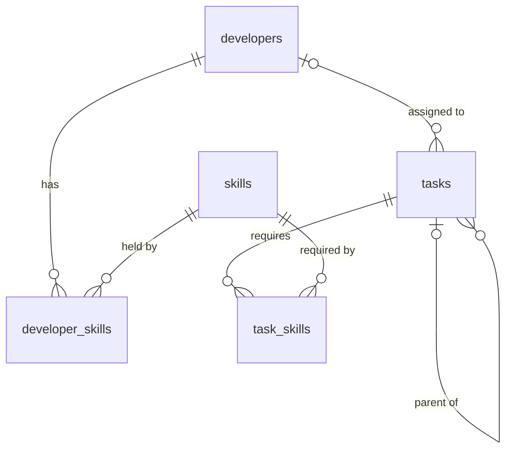

# Task Assignment App

Full-stack task assignment app: Developers, Skills and Tasks (with unlimited nested subtasks). A task can only be assigned to a developer whose skills cover the task's required skills; tasks created without skills get them inferred by an LLM on the backend.

> Status: **Phase P5 (LLM skill inference)**. Sections marked _TBD_ are filled in by later phases.

## Tech stack

| Layer | Choice |
|---|---|
| Backend | NestJS 11 + TypeScript (strict), Prisma 7 (driver adapters) |
| Database | PostgreSQL 17 (Docker / deployment / migrations); SQLite for local development |
| LLM | Google Gemini via `@google/genai` (optional; keyword fallback) |
| Frontend | Vite + React 19 + TypeScript (strict), React Router, TanStack Query, Tailwind CSS |
| Tests | Backend: Jest + supertest. Frontend: Vitest + React Testing Library |
| Deployment | Docker multi-stage builds, nginx reverse proxy |

## Quick start

### Prerequisites
- Node.js LTS (24.x), npm 11
- Docker Desktop (only for PostgreSQL and the full stack)

### Local development (Windows PowerShell)

```powershell
# Backend (SQLite, no Docker needed)
cd backend
npm install
Copy-Item .env.example .env
npm run db:reset        # rebuild SQLite: schema -> db push -> generate -> seed
npm run start:dev       # http://localhost:3000/api, Swagger UI at /api/docs

# Frontend
cd ..\frontend
npm install
npm run dev             # http://localhost:5173 (proxies /api to the backend)
```

The Vite dev server proxies `/api` to `http://localhost:3000`, mirroring the same-origin nginx setup in production, so no CORS is needed. If the backend runs elsewhere, set `API_PROXY_TARGET` before `npm run dev` (for example `$env:API_PROXY_TARGET="http://localhost:3001"`). This is read only by the dev server and never bundled.

### PostgreSQL (migrations and PG e2e)

```powershell
Copy-Item .env.example .env                       # repo root, for docker compose
docker compose up -d db                           # 127.0.0.1:5433, healthcheck
cd backend
Copy-Item .env.pg.example .env.pg
# Change POSTGRES_PASSWORD in .env and keep it in sync with .env.pg
npm run db:migrate:pg -- --name <migration_name>  # the only way to create migrations
npm run test:e2e:pg
```

### Full stack with Docker
_TBD (Phase P6)_: `docker compose up --build` -> http://localhost:8080

### Windows notes
- npm scripts are cross-platform (no `rm -rf` / `export`); files use LF line endings via `.gitattributes`.
- Stop `start:dev`, Prisma Studio and DB clients before `npm run db:reset` (Windows locks `dev.db`).
- `better-sqlite3` is a native module; use a Node LTS release so prebuilt binaries are available.

## Configuration
_Full table: TBD (Phase P7)_. See [`.env.example`](.env.example), [`backend/.env.example`](backend/.env.example) and [`backend/.env.pg.example`](backend/.env.pg.example).

| Variable | Default | Purpose |
|---|---|---|
| `GEMINI_API_KEY` | _(empty)_ | Optional. Enables LLM skill inference. Free key from Google AI Studio (Google account needed, no credit card). Without it the app uses keyword rules and logs a warning. |
| `GEMINI_MODEL` | `gemini-3.1-flash-lite` | Gemini model name; check AI Studio for currently available models. |

## System design
_Architecture diagram: TBD (Phase P7)_. Business rules and concurrency: see [API](#api).

### Frontend (Phases P3–P4)

| Route | Page |
|---|---|
| `/` | Task tree: Title / Skills / Status / Assignee. Subtasks are indented under their parent and collapsible; status and assignee change in place. |
| `/tasks/new` | Create a task with nested subtasks (1 / 1.1 / 1.1.1 …), each with its own optional skills; the whole tree is saved in one request. |

- **Server state** lives only in TanStack Query (`features/tasks/queries.ts`); the create form's tree lives in a `useReducer` (`task-draft.ts`: `ADD_SUBTASK`, `REMOVE_NODE`, `UPDATE_TITLE`, `TOGGLE_SKILL`, `RESET`, addressed by path).
- **Recursive editor (Composite):** `TaskNodeEditor` renders one task and itself for each subtask. "Add subtask" is disabled at 5 levels or 50 tasks; a new subtask's title takes focus; the first invalid title is focused on submit; nested API field errors (`subtasks.0.subtasks.1.title`) appear next to the right subtask.
- **Optimistic updates:** status and assignee changes update the cached tree immediately. If the API refuses, only that task's own fields are restored and the backend's reason (e.g. `SKILL_MISMATCH` detail) is announced. Either way the tree is refetched.
- **Inferred skills:** a task whose skills were chosen by the LLM shows an "AI" badge; one labelled by the keyword fallback shows "Auto" (keyword matching isn't presented as AI). Both carry a screen-reader description. The create form explains that empty skills are detected from the title.
- **Done rule hint:** "Done" is disabled while any subtask (at any depth) is open; the backend still enforces it (422 `SUBTASKS_NOT_DONE`).
- **Cascade confirmation (D5):** reopening a Done task under Done parents opens `ConfirmCascadeDialog` (native `<dialog>` + `showModal()`, focus on Cancel, Esc cancels) listing the parents that will go back to In Progress. If the cached tree didn't predict it, the server's 409 opens the same dialog with its `affectedTasks`. Cancel leaves everything unchanged; confirm resubmits with `confirmCascade: true`, without optimistic update, then refetches the tree and announces how many tasks changed.
- **Assignee options** list only developers whose skills cover the task (same superset rule as the backend, which still enforces it). With no eligible developer the select explains why.
- **API client** (`api/client.ts`): same-origin `fetch` to `/api`, parses RFC 7807 errors into `ApiError`. Field errors from a 400 are shown next to their form field. Queries retry only on network/5xx errors, mutations never.
- **Accessibility:** semantic `<table>` with column headers, a visually hidden label for every select, a `<fieldset>`/`<legend>` for skills, errors linked with `aria-describedby` and `aria-invalid`, feedback in an `aria-live="polite"` region, a skip link, and everything usable by keyboard.
- **Responsive:** below the `md` breakpoint each table row becomes a card. Cells stack and show their column name via `data-label`, so there is one DOM and no duplicated controls.
- **Robustness:** pages are lazy-loaded per route; a router error boundary shows a recoverable message instead of raw errors; loading, empty and error states are handled.

### Prisma generated client
`prisma generate` turns `schema.prisma` into a TypeScript client in `backend/src/generated/prisma/` (gitignored). Prisma 7 emits it into the source tree instead of `node_modules`, so it compiles with the app and is imported like any module (`../generated/prisma/client`). It is regenerated automatically by `start:dev`, `db:reset`, `test:e2e` and `test:e2e:pg`. The client is specific to one database provider, so it must be regenerated when switching between SQLite and PostgreSQL.

### Data model



| Table | Notes |
|---|---|
| `skills` | `name` unique, varchar(50) |
| `developers` | `name` varchar(100) |
| `developer_skills` | PK (`developer_id`, `skill_id`); deleting a developer cascades, deleting a skill in use is restricted |
| `tasks` | `title` varchar(500) + PG `CHECK (length(trim(title)) > 0)`; `status` enum `TODO`/`IN_PROGRESS`/`DONE`; `assignee_id` set to NULL when the developer is deleted; `parent_id` → `tasks` (subtasks are deleted with their parent); `position` orders siblings |
| `task_skills` | PK (`task_id`, `skill_id`); cascades with the task, restricted for skills |

- Primary keys are UUIDs generated by Prisma (`@default(uuid())`), so the same schema works on SQLite and PostgreSQL.
- Indexes: `idx_tasks_parent_id`, `idx_tasks_assignee_id`, `idx_task_skills_skill`, `idx_dev_skills_skill` (the composite PKs already cover lookups by their leading column).
- Migrations live in `backend/prisma/migrations/` for PostgreSQL only and show the schema's evolution: `init` (P1, with a hand-added CHECK constraint that Prisma cannot express), `add_subtasks` (P4: `parent_id`, its index, `position`) and `add_skill_source` (P5: the `skill_source` enum `USER`/`LLM`/`FALLBACK`). On SQLite neither the CHECK nor the enum is enforced, so the API validates both.
- `position` is an addition to the original plan: siblings created in one request can share a `created_at` millisecond and their random UUIDs carry no order, so without it 1.1 and 1.2 could swap.
- Seed (`prisma/seed.ts`) is idempotent: fixed UUIDs (`prisma/seed-data.ts`) + `upsert`, and each seeded developer's skill set is reset to the seed's: Alice [Frontend], Bob [Backend], Carol [Frontend, Backend], Dave [Backend].
- The seed also creates sample tasks: a parent → child → nested tree ("Launch the user profile feature" → "Build the profile API" → "Add the profile picture upload endpoint" / "Validate image type and size", plus "Design the profile page" → "Make the profile page responsive") with mixed statuses and assignees, and two stand-alone user stories from the brief. Seeded tasks are reset to their seed values on every run; tasks created in the app are left alone. Because the seed bypasses the API, an e2e test checks the sample data against the real `SkillMatchRule` and `AllDescendantsDoneRule`.
- `PrismaService` is a global singleton built on `createPrismaClient()`; it connects on module init and disconnects on shutdown (`enableShutdownHooks`).

### Local SQLite + production PostgreSQL
`backend/prisma/schema.prisma` (PostgreSQL) is the single source of truth. `scripts/gen-sqlite-schema.ts` derives the SQLite schema, `prisma.config.ts` picks the schema from `DATABASE_URL`, and `createPrismaClient()` picks the matching driver adapter. Migrations exist only for PostgreSQL; SQLite is rebuilt with `db push`. `db:reset` refuses to run in production, against a non-`file:` URL, or on a file outside `backend/prisma/`. The PostgreSQL scripts (`db:migrate:pg`, `db:reset:pg`, `test:e2e:pg`) load `.env.pg` with override (`dotenv -o`) and first run `scripts/assert-local-pg.ts`, which refuses non-local hosts and production, so a `DATABASE_URL` left in the shell can never be reset.

## API

Base path `/api`. Swagger UI is at **http://localhost:3000/api/docs** (OpenAPI JSON at `/api/docs-json`). It is on by default and off when `NODE_ENV=production` unless `ENABLE_SWAGGER=true`.

| Method | Path | Body | Success | Errors |
|---|---|---|---|---|
| GET | `/health` | | 200 `{status:"ok"}` (DB probed) | 503 |
| GET | `/skills`, `/skills/:id` | | 200 skill(s) with `developers[]` | 400 bad UUID, 404 |
| GET | `/developers`, `/developers/:id` | | 200 developer(s) with `skills[]`, `tasks[]` | 400, 404 |
| GET | `/tasks` | | 200 `TaskNode[]`: top-level tasks with `subtasks` nested recursively | |
| GET | `/tasks/:id` | | 200 `TaskNode` with its whole subtree | 400, 404 |
| POST | `/tasks` | `{ title, skillIds?, subtasks? }` (recursive) | 201 `TaskNode` tree (status `TODO`, unassigned) | 400 (incl. depth > 5 or > 50 tasks), 422 `UNKNOWN_SKILL`, 429 |
| PATCH | `/tasks/:id/status` | `{ status, confirmCascade? }` | 200 `{ task, cascadedTaskIds }` | 400, 404, 422 `SUBTASKS_NOT_DONE`, 409 `CASCADE_CONFIRMATION_REQUIRED` |
| PATCH | `/tasks/:id/assignee` | `{ developerId: uuid \| null }` | 200 `TaskNode` | 400, 404, 422 `SKILL_MISMATCH` / `UNKNOWN_DEVELOPER` |

- **Validation:** unknown fields are rejected at every level (so `POST /tasks` cannot set `status`, `assigneeId`, `parentId` or `position`). `title` is trimmed and must be 1–500 characters with no control characters. `skillIds` are UUIDs, deduplicated, at most 20 per task. A tree may be at most 5 levels deep and 50 tasks per request (decision D10). That limit is checked iteratively on the raw JSON before DTO transformation and again in the service, and every route also rejects any JSON nested more than 32 levels, so a deeply nested body is a 400, never a stack overflow. Path ids must be UUIDs. JSON bodies are limited to 100kb.
- **Errors:** every error is `application/problem+json` (RFC 7807): `{ type, title, status, detail, instance, code?, errors? }`, plus extensions such as `missingSkills`, `unknownSkillIds`, `openSubtasks` or `affectedTasks`. Nested field errors use dotted paths (`subtasks.0.title`). Responses never contain stack traces, SQL or library messages; 5xx details are generic and the real error is only logged.
- **Rate limits:** a global budget (`THROTTLE_LIMIT` per `THROTTLE_TTL_MS`) plus a stricter one for `POST /tasks` (`THROTTLE_CREATE_TASK_LIMIT`), because creation will call the LLM. `/health` is not throttled.
- **Skill inference:** tasks created without `skillIds` get skills inferred from their own title (D8); `skillSource` says how (`USER`, `LLM` or `FALLBACK`). See [Skill inference](#skill-inference-llm).

### Skill inference (LLM)

```
POST /tasks
  1. Collect every node of the tree without skillIds          (user-chosen skills stay USER)
  2. classifier.classifyBatch(titles, skill names from the DB)  ← one call per tree, before any transaction
  3. Transaction: validate skills, write the whole tree with skill_source
```

| Component | Pattern | Role |
|---|---|---|
| `SkillClassifier` | Strategy | `classifyBatch(items, allowedSkills)`; implementations are swappable (and mocked in tests) |
| `GeminiClassifier` | Adapter | Wraps `@google/genai`; the SDK's types never leave the `skill-inference` module |
| `ResilientClassifier` | Decorator | 10s timeout (request aborted), one retry with backoff on 429/5xx/network errors, then falls back to keywords for anything left unlabelled → `FALLBACK` |
| `KeywordClassifier` | Strategy | Deterministic rules (UI/page/responsive → Frontend; API/database/logs/audit/security → Backend; upload/profile → both). A title matching nothing requires every skill (conservative), so a task never ends up without skills (D6) |
| `createSkillClassifier` | factory | With `GEMINI_API_KEY`: Resilient(Gemini → Keyword). Without: Keyword only, plus a startup warning |

**Prompt-injection and output safety:**
- The system instruction states that titles are untrusted data to classify, never instructions.
- Titles are sent only inside a JSON payload, not spliced into the instruction text.
- The response is constrained by `responseSchema` (JSON with an `enum` of the database's skill names, temperature 0), parsed and re-validated with zod; unknown skill names and unknown task ids are dropped.
- The model's free text is never returned to the client or stored: only skill ids from the database are written.
- Logs contain counts and HTTP status codes only, never titles, SDK messages or the API key.

**Privacy note:** with a key configured, task titles without skills (up to 50 per request) are sent to Google's Gemini API, and on the free tier Google may use inputs to improve its products. Don't put personal or confidential data in titles, or leave `GEMINI_API_KEY` empty to keep everything local. Only the resulting skill labels are stored.

**Limits:** one LLM call per created tree, `maxOutputTokens` capped, response arrays bounded by zod, at most ~20.5s in the worst case (10s timeout, 0.5s backoff, one 10s retry) before the keyword fallback, and `POST /tasks` has its own stricter rate limit. The classifier runs before the database transaction, so a slow LLM never holds a database connection.

**Acceptance examples (PLAN §5)**, covered by unit and e2e tests with the keyword fallback: "responsive homepage…" → Frontend; "audit logs of all data access…" → Backend; "update my profile information and upload a profile picture…" → Frontend + Backend.

### Business rules and concurrency
- **Skill match (decision D3):** a developer can take a task only if their skills include all of the task's skills. Violations return 422 `SKILL_MISMATCH` listing `missingSkills`. Subtasks follow the same rule (D9) and have their own skills (D8).
- **Done rule (D4):** a task can be Done only when every descendant at any depth is Done; otherwise 422 `SUBTASKS_NOT_DONE` listing `openSubtasks`.
- **Cascade rollback (D5):** reopening a Done task whose ancestors are Done returns 409 `CASCADE_CONFIRMATION_REQUIRED` with `affectedTasks` (nearest first) and changes nothing. Resubmitting with `confirmCascade: true` sets the task and moves every Done ancestor to `IN_PROGRESS` in the same transaction, recomputing the affected set rather than trusting the client's. This keeps the invariant "parent Done ⇒ all descendants Done".
- Rules form a chain (`runRuleChain`) that returns `allow` (optionally with tasks to cascade), `reject` (→ 422) or `requireConfirmation` (→ 409). The service loads the task, its ancestors and its descendants, and the rules are pure functions of that snapshot, unit-tested without a database.
- **Transactions and locking:** creating a tree is one transaction (Prisma nested create). A status change finds the task's ancestors and descendants with `WITH RECURSIVE` queries, **locks all of those rows** (`RowLockStrategy`), re-reads them, evaluates the rules and writes, all in one transaction. The locked ids can be read before locking because the tree shape never changes after creation (no re-parenting or delete endpoints). PostgreSQL uses `SELECT … FOR UPDATE` ordered by id (consistent lock order, no deadlocks); SQLite needs no row lock because it allows one writer at a time. This is the only place where the two SQL dialects differ. The recursive CTEs are shared: with the `pg` driver adapter, bound parameters are untyped and PostgreSQL infers `uuid`, so no cast is needed.

## Design patterns

| Pattern | Where | Why |
|---|---|---|
| Strategy | `RowLockStrategy` (PG / SQLite) | Keeps the one dialect difference (`FOR UPDATE`) out of business code |
| Chain of Responsibility | `SkillMatchRule`; `AllDescendantsDoneRule` → `AncestorRollbackRule`, via `runRuleChain` | New rules are added without touching the service; each rule is tested alone; a hard rejection (422) wins over a confirmation request (409) by ordering |
| Composite | Backend `buildTaskForest` (`TaskNode.subtasks` are `TaskNode`s); frontend `TaskNodeEditor` renders itself per subtask | A task and a tree of tasks are handled the same way, so creation, reading and the editor work at any depth |
| Facade | `TasksService` | Controllers call one method per use case; transactions, locks, rules and persistence stay hidden |
| Strategy | `SkillClassifier`: `GeminiClassifier` / `KeywordClassifier` (and test doubles) | Skill inference can change provider, or run without one, without touching task creation |
| Adapter | `GeminiClassifier` wraps `@google/genai` | The SDK's request/response types stay inside `skill-inference`; the rest of the app sees plain data |
| Decorator | `ResilientClassifier` | Timeout, retries and fallback are added around any classifier without changing it, and are unit-tested on their own |

## Dependency choices

| Dependency | Why |
|---|---|
| NestJS 11 (not 12) | Nest 12 packages are ESM-only, which conflicts with Jest (required test runner) and the CommonJS Prisma setup; Nest 11 is still supported and CommonJS |
| `prisma`, `@prisma/client` 7 | Typed data access and migration history; v7 requires driver adapters |
| `@prisma/adapter-pg` | Runtime adapter for PostgreSQL (production) |
| `@prisma/adapter-better-sqlite3` (dev) | Runtime adapter for local SQLite; dev-only so the production image has no native SQLite module |
| `dotenv` | Loads `.env` for `prisma.config.ts`, scripts and seed |
| `dotenv-cli` (dev) | Runs Prisma/Jest against `.env.pg` without shell-specific env syntax |
| `tsx` (dev) | Runs TypeScript scripts (`db-reset`, schema generator, seed) cross-platform without a build step |
| `class-validator`, `class-transformer` | Declarative whitelist DTO validation and transformation for Nest's `ValidationPipe` |
| `@nestjs/swagger` | OpenAPI document and Swagger UI generated from the controllers and DTOs |
| `helmet` | Secure HTTP response headers (CSP, nosniff, frameguard, …) with safe defaults |
| `@nestjs/throttler` | In-process rate limiting (global + stricter task creation); no Redis needed for a single instance |
| `@google/genai` | Google's official Gemini SDK (required by the brief's LLM choice); supports JSON-schema-constrained output and abort signals |
| `zod` | Runtime validation of the LLM's JSON output before it is trusted |
| ESLint + typescript-eslint + Prettier | Type-aware linting and consistent formatting (replaces the oxlint default of current scaffolds to match CLAUDE.md) |
| `eslint-plugin-react-hooks`, `eslint-plugin-react-refresh` (frontend, dev) | Catch hook-rule violations and HMR-unsafe exports |
| `react-router` (frontend) | Client-side routing with route-level code splitting; the standard React router |
| `@tanstack/react-query` (frontend) | Server-state cache with built-in optimistic-update hooks, rollback and refetching |
| `tailwindcss`, `@tailwindcss/vite` (frontend, dev) | Utility CSS compiled at build time to a static stylesheet: no runtime CSS-in-JS and no inline styles, which keeps a strict CSP possible |
| Vitest, React Testing Library, jsdom, `@testing-library/jest-dom`, `@testing-library/user-event` (frontend, dev) | Vite-native test runner; user-centric, accessibility-oriented component tests |

## Security
_TBD (Phase P7)_.

## Assumptions and decisions
| # | Question | Decision |
|---|---|---|
| D1 | Authentication | Not in v1; treated as an explicit assumption. The architecture leaves room for a Nest Guard. |
| D2 | Task statuses | `TODO` / `IN_PROGRESS` / `DONE`, shown in the UI as "To-do" / "In Progress" / "Done". |
| D3 | Skill-match semantics | A developer's skills must be a **superset** of the task's required skills. |
| D4 | Scope of the "Done" rule | A task can be Done only when **all descendants** are Done (checked with a recursive CTE), not just its direct children. |
| D5 | Reopening a subtask whose parent is Done | **Cascade rollback with confirmation:** every Done ancestor is moved back to `IN_PROGRESS`. Without confirmation the server returns 409 listing the affected ancestors; the client confirms and resubmits with `confirmCascade: true`. This keeps the invariant "parent Done ⇒ all descendants Done". |
| D5b | Target status of the rollback | `IN_PROGRESS`: some of the parent's work is already complete, so this is more accurate than `TODO`. |
| D6 | A task ends up with no skills | Not allowed. If the user picks none, the LLM infers them; if the LLM fails or returns nothing, the keyword classifier is the fallback. |
| D7 | Unassigning | Allowed with `developerId: null`. |
| D8 | Subtask skills | Independent of the parent; each task's skills are inferred from its own title. |
| D9 | Subtask assignee | Same rules as any task, including the skill match. |
| D10 | Nesting limits | Maximum depth 5 and at most 50 nodes per create request (DoS protection). |
| D11 | Editing a task's skills / deleting tasks | Not required by the brief; not provided in v1. |
| D12 | LLM model | Configured via `GEMINI_MODEL`; defaults to the Gemini 3.x Flash family (e.g. `gemini-3.1-flash-lite`). |
| D13 | Local database | **SQLite** for day-to-day development (no Docker, rebuilt in seconds); **PostgreSQL** for deployment, Docker, migrations and PG e2e. `schema.prisma` (PostgreSQL) is the single source of truth and the SQLite schema is generated from it. |
| D14 | Concurrency control | `RowLockStrategy`: PostgreSQL locks the affected task rows with `SELECT … FOR UPDATE` inside the transaction; SQLite is a no-op because it allows only one writer at a time. |

## Testing
```powershell
cd backend;  npm run lint; npm test; npm run test:e2e
npm run test:e2e:pg      # needs `docker compose up -d db`
cd ..\frontend; npm run lint; npm test
```

`test:e2e` / `test:e2e:pg` regenerate the Prisma client for their dialect first, because the generated client is provider-specific. Jest compiles TypeScript through `tsconfig.jest.json` (plain CommonJS) so the Prisma 7 client's dynamic `import()` of its WASM query compiler works inside Jest's sandbox.

Backend tests: unit tests for every rule (incl. "a grandchild still open blocks Done" and the cascade cases), the iterative tree-limit check (also on a 100,000-level input), the forest builder and the rule chain; e2e (SQLite and PostgreSQL) for every endpoint, including creating the 1 / 1.1 / 1.1.1 / 1.1.2 tree in one request, depth 6 / 51 tasks / a ~100kb pathologically deep body → 400, nested field errors, an unknown nested skill writing nothing, and the full cascade: all Done → reopen a leaf without confirmation → 409 with the database unchanged → with confirmation → leaf To-do, both ancestors In Progress, sibling still Done.

Frontend tests (Vitest + React Testing Library, `fetch` mocked) cover: the eligibility rule (Carol qualifies for a Frontend + Backend task, Alice does not), assignee options, the draft reducer (add/remove/update nested nodes, limits, nested server-error mapping), tree flattening and collapse, Done disabled while subtasks are open, the cascade dialog (opens from the cache, Cancel leaves the value and sends nothing, Confirm sends `confirmCascade` and refreshes, a stale-cache 409 opens it with the server's list), the optimistic status change rolling back on a 422, assignment success and rollback, building and saving the wireframe tree with keyboard focus moving to new subtasks, and route-level lazy loading.

## Roadmap
Planned for v2, highest priority first. Items tagged with a phase came from that phase's security review.

| Priority | Item |
|---|---|
| High | User authentication and role-based permissions (a Guard slot is already reserved). |
| High | Separate the migration DB user from the runtime DB user (least privilege). |
| Medium | CI: lint, tests, `npm audit`, gitleaks, Semgrep, Trivy image scanning. |
| Medium | Structured logging (pino) with correlation IDs and audit logs. |
| Medium | Make LLM skill inference asynchronous (domain events / Observer + outbox) so task creation does not wait for the LLM. |
| Medium | Generate frontend types from OpenAPI (`openapi-typescript`) instead of hand-written types. |
| Medium | [P0] `db-reset.ts` checks the target path lexically (`path.resolve`), so a symlink/junction inside `prisma/` could bypass it; use `realpathSync` and require a `*.db` suffix. |
| Medium | [P2] Behind the reverse proxy, rate limits would count the nginx IP for everyone; fixed in P6 with `trust proxy` and `X-Forwarded-For`. |
| Low | Use the State pattern for status transitions if the rules grow more complex. |
| Low | Edit task skills, delete tasks, paginate and filter tasks. |
| Low | Playwright end-to-end tests. |
| Low | Database triggers as defence in depth for the skill-match rule. |
| Low | Cascade confirmations carry `expectedAffectedIds`, so the server asks again if the affected set changed (today `confirmCascade: true` is a blanket yes; flagged again in the P4 review). |
| Low | [P0] `db-reset.ts`: strip `?query` from `DATABASE_URL`, compare `NODE_ENV` case-insensitively, and call `npx --no-install tsx`. |
| Low | [P0] Pin the PostgreSQL image by digest, not only by tag. |
| Low | [P1] The seed upserts skills by `id`; an existing skill with the same name but another id makes it fail (the transaction rolls back, no data loss). Upsert by `name` instead. |
| Low | [P1] `skills.name` uniqueness is case-sensitive ("Frontend" and "frontend" could coexist); normalise skill names in the application before P5. |
| Low | [P1] Seed errors print the full message, which may include the DB host or name (never the password); print only the error code in CI. |
| Low | [P2] Nest turns `URIError` and unmatched routes into messages that echo the raw path; return a fixed message per status instead. |
| Low | [P2] Interactive transactions use Prisma's defaults (`maxWait` 2s, `timeout` 5s); under heavy contention the timeout (P2028) becomes a 500. Map it to 503 with `Retry-After` or set explicit limits. |
| Low | [P2] `/api/health` is not rate limited and queries the DB on each call; restrict it to the internal network in P6. |
| Low | [P2] Add an e2e test for concurrent PATCHes on the same task (verifies `FOR UPDATE` serialisation). |
| Low | [P5, accepted] All titles of a tree go to the LLM in one request, so one title could try to steer the labels of its siblings. The impact is limited to the attacker's own request and labels stay within the skill enum; the system instruction tells the model each title describes only its own task. |
| Low | [P4] The 422 `openSubtasks` and 409 `affectedTasks` responses include other tasks' titles. Fine in v1 (no auth; `GET /tasks` already shows every title), but they must be filtered by visibility once authentication exists. |
| Low | [P4] `npm audit --omit=dev` (backend) reports 2 moderate js-yaml advisories via `@nestjs/swagger`; no High/Critical. Re-check in P7. |
| Low | [P3] The frontend `fetch` ignores TanStack Query's abort `signal` and has no timeout, so `cancelQueries` doesn't abort in-flight requests and a hung `/api` keeps the page loading. Pass the `signal` combined with `AbortSignal.timeout(...)`. |

Accepted by design: on SQLite the `status` enum is unconstrained TEXT and the title CHECK constraint does not exist, so the API validates both itself.

## AI-assisted development
_TBD (Phase P7)_.
